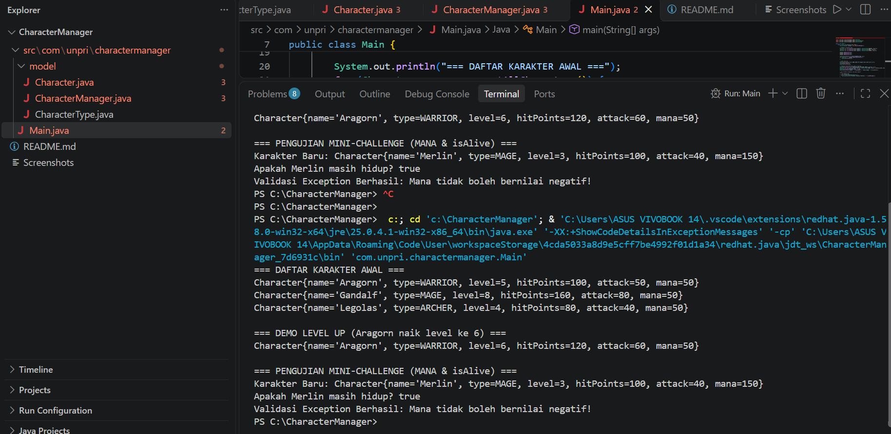
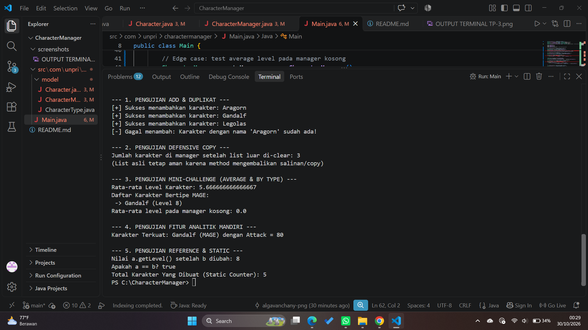

# Character Manager — TP3 (Java Visual SIH-6406)

Aplikasi **Character Manager** ini dikembangkan untuk mengelola data karakter game berbasis *Object-Oriented Programming* (OOP) menggunakan Java. Pada Sprint #1 (TP3), proyek ini difokuskan pada implementasi struktur model class dasar, penerapan enkapsulasi atribut, validasi *exception* pada atribut *mana*, serta pengujian status hidup karakter menggunakan method `isAlive()`.

## 📸 Tangkapan Layar (Screenshot) Output Terminal


## 📂 Struktur Folder Proyek
```text
CharacterManager/
├── screenshots/
│   └── OUTPUT TERMINAL TP-3.png
├── src/
│   └── com/
│       └── unpri/
│           └── charactermanager/
│               ├── model/
│               │   ├── Character.java
│               │   ├── CharacterManager.java
│               │   └── CharacterType.java
│               └── Main.java
└── README.md

#Character Manager — TP5 / Sprint #2 (Java Visual SIH-6406)

Aplikasi Character Manager ini dikembangkan untuk mengelola data karakter game berbasis Object-Oriented Programming (OOP) menggunakan Java. Pada Sprint #2 (TP5), proyek ini diperluas dengan penerapan overriding equals(), pencegahan duplikasi nama karakter, defensive copy pada pengelolaan list, penambahan method analitik mandiri, serta analisis konseptual terkait manajemen memori dan reference.

## 📸 Tangkapan Layar (Screenshot) Output Terminal


## 📂 Struktur Folder Proyek
```text
CharacterManager/
├── screenshots/
│   └── OUTPUT TERMINAL TP5.png
├── src/
│   └── com/
│       └── unpri/
│           └── charactermanager/
│               ├── model/
│               │   ├── Character.java
│               │   ├── CharacterManager.java
│               │   └── CharacterType.java
│               └── Main.java
└── README.md
# Character Manager — TP8 / Sprint #3 (Java Visual SIH-6406)

Aplikasi Character Manager bertransformasi dari aplikasi berbasis console* menjadi aplikasi berbasis GUI (*Graphical User Interface*) menggunakan Java Swing. Pada Sprint #3 (TP8) ini, fokus utama adalah penerapan pemrograman *event-driven*, arsitektur MVC (*Model-View-Controller*), serta penyajian data dinamis ke dalam komponen jendela grafis.

## 📸 Tangkapan Layar (Screenshot) MainWindow & Statistik
*Sebelum / Data Awal (Before):
  
*Sesudah Perubahan Data (After):
  

## 📂 Struktur Folder Proyek
```text
CharacterManager/
├── screenshots/
│   ├── OUTPUT TERMINAL TP-3.png
│   ├── OUTPUT TERMINAL TP5.png
│   ├── OUTPUT TERMINAL TP8 BEFORE.png
│   └── OUTPUT TERMINAL TP8 AFTER.png
├── src/
│   └── com/
│       └── unpri/
│           └── charactermanager/
│               ├── model/
│               │   ├── Character.java
│               │   ├── CharacterManager.java
│               │   └── CharacterType.java
│               ├── view/
│               │   └── MainWindow.java
│               └── Main.java
└── README.md
🔄 Alur Data & Hubungannya dengan MVC (Bagian C)
Alur data dimulai dari Main yang menginisialisasi CharacterManager (selaku komponen Model yang menyimpan data objek). Selanjutnya, MainWindow (selaku View) mengambil data koleksi karakter tersebut menggunakan method getAllCharacters() secara defensif tanpa merusak enkapsulasi. Terakhir, antarmuka memperbarui komponen JLabel dan statistik secara dinamis berdasarkan pembaruan data tersebut, mencerminkan prinsip pemisahan tugas (separation of concerns) dalam arsitektur MVC.

👥 Daftar Karakter Baru & Alasan Pemilihan
Arthas (WARRIOR, Level 7): Dipilih untuk memperkuat barisan petarung jarak dekat dengan kapasitas HitPoints dan Attack yang tinggi.

Jaina (MAGE, Level 6): Ditambahkan untuk memberikan variasi pada tipe penyihir dengan atribut Mana yang besar guna mendukung keseimbangan perhitungan rata-rata level.

👤 Identitas & Analisis Tugas
Nama Lengkap: Alga Vancany Yunita Purba

NIM: 253303621269

Kelas: Sistem Informasi Pagi 3-B

Link Google Docs Analisis (Bagian D):https://docs.google.com/document/d/1Hj7ydaICSuB1yNE1RJtG0xxb4lDeT7WdjJKfeLuvxrA/edit?usp=sharing - DOCS
## 🌟 TP10 — Character Manager Sprint #4 (Theming, Properti Komponen & MVC)

Pada sprint ke-4 ini, antarmuka aplikasi ditingkatkan dengan penerapan sistem *theming* terpusat melalui class `AppTheme`, konfigurasi properti komponen GUI secara profesional, serta pemisahan tanggung jawab arsitektur MVC yang ketat.

### 📸 Tangkapan Layar (Screenshot) Output TP10


### 📂 Struktur Folder Proyek
```text
CharacterManager/
├── screenshots/
│   ├── OUTPUT TERMINAL TP-3.png
│   ├── OUTPUT TERMINAL TP5.png
│   ├── OUTPUT TERMINAL TP8 AFTER.png
│   ├── OUTPUT TERMINAL TP8 BEFORE.png
│   └── OUTPUT TERMINAL TP10.png
├── src/
│   └── com/
│       └── unpri/
│           └── charactermanager/
│               ├── model/
│               │   ├── Character.java
│               │   ├── CharacterManager.java
│               │   └── CharacterType.java
│               ├── view/
│               │   ├── AppTheme.java
│               │   └── MainWindow.java
│               └── Main.java
└── README.md